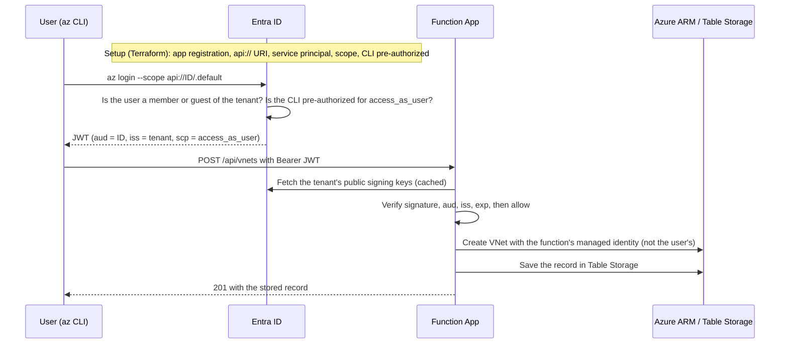

# Azure VNet API

Serverless REST API (Azure Functions, Python 3.11) that creates a Virtual Network with multiple subnets, stores the result in Azure Table Storage, and lets authenticated users retrieve it.

## Architecture

```
Client ──Bearer JWT──▶ Azure Function (HTTP) ──▶ Azure Network (ARM SDK)
                          │  validates Entra ID token      (VNet + subnets)
                          └──▶ Azure Table Storage (record of each created VNet)
```

- **Auth**: Microsoft Entra ID. The function validates the JWT (signature via tenant JWKS, issuer, audience, expiry). **Authorization is open: any valid token for this API from the tenant is accepted** (roles and scopes are not checked).
- **Azure access**: the Function App's system-assigned managed identity (the app code holds no secrets) with `Network Contributor` on the resource group and `Storage Table Data Contributor` on the storage account. The Functions host itself still uses the storage account key for `AzureWebJobsStorage`.
- **Storage**: Table `vnets` (PartitionKey `vnet`, RowKey = VNet name). Chosen for being serverless and cheap; Cosmos DB would be the swap for richer queries.
- **IaC**: Terraform (`infra/`, providers `azurerm` + `azuread`); `deploy.sh` automates everything; GitHub Actions runs tests and deploys.

## End-to-end flow



The Entra setup is `azuread_application` (API identity, scope, token version), `azuread_application_identifier_uri` (`api://<client-id>`), `azuread_service_principal` (the API's instance in the tenant) and `azuread_application_pre_authorized` (lets the Azure CLI request the scope without a consent prompt).

## API

| Method | Path | Description |
|---|---|---|
| GET | `/api/health` | Unauthenticated health check |
| POST | `/api/vnets` | Create VNet + subnets, store result (201) |
| GET | `/api/vnets` | List stored VNets |
| GET | `/api/vnets/{name}` | Get one stored VNet |

Errors: 400 validation, 401 auth, 404 not found, 409 name already exists, 500 unexpected error.

Create request:
```json
{
  "name": "demo-vnet",
  "location": "westus2",
  "addressSpace": ["10.0.0.0/16"],
  "subnets": [
    {"name": "web", "addressPrefix": "10.0.1.0/24"},
    {"name": "db",  "addressPrefix": "10.0.2.0/24"}
  ]
}
```
Validation: valid VNet and subnet names, valid CIDRs, subnets inside the address space, no overlaps, unique subnet names. `location` is optional and defaults to `DEFAULT_LOCATION` (`westus2`).

## Deploy (automated)

Prereqs: Azure CLI (`az login`), Terraform >= 1.5, Functions Core Tools v4, Python 3.11, rights to create role assignments and app registrations.

```bash
./deploy.sh        # optional env: RG, LOCATION, SUB
```
Terraform creates the resource group, the Entra app registration (`api://<clientId>`, with an `access_as_user` scope and the Azure CLI pre-authorized), storage, App Insights, a Consumption Function App with managed identity and its role assignments; then the script publishes the code. It prints `API_URL` and `API_CLIENT_ID`. Tear down with `terraform -chdir=infra destroy -var subscription_id=<id>`.
State is local by default; use an `azurerm` backend for team use.

### CI/CD
`.github/workflows/ci-deploy.yml` runs tests on every push/PR and deploys on `main` when repo variable `AZURE_FUNCTIONAPP_NAME` and secrets `AZURE_CLIENT_ID`, `AZURE_TENANT_ID`, `AZURE_SUBSCRIPTION_ID` (OIDC federated credential, set up manually: Terraform does not create it) are set.

## Try it

The helper script gets a token and the API URL for you (from `az` and Terraform outputs):

```bash
scripts/api.sh health
scripts/api.sh create demo-vnet 10.0.0.0/16 web=10.0.1.0/24 db=10.0.2.0/24
scripts/api.sh list
scripts/api.sh get demo-vnet
scripts/api.sh noauth        # 401 without a token
```

Or call the API directly with `curl`:

```bash
az login --tenant <tenant-id> --scope api://$API_CLIENT_ID/.default
TOKEN=$(az account get-access-token --scope api://$API_CLIENT_ID/.default --query accessToken -o tsv)

curl -X POST $API_URL/vnets -H "Authorization: Bearer $TOKEN" -H "Content-Type: application/json" \
  -d '{"name":"demo-vnet","addressSpace":["10.0.0.0/16"],"subnets":[{"name":"web","addressPrefix":"10.0.1.0/24"},{"name":"db","addressPrefix":"10.0.2.0/24"}]}'

curl $API_URL/vnets -H "Authorization: Bearer $TOKEN"
curl $API_URL/vnets/demo-vnet -H "Authorization: Bearer $TOKEN"
curl -i $API_URL/vnets          # 401 without token
```
Terraform exposes the `access_as_user` scope and pre-authorizes the Azure CLI client (`04b07795-8ddb-461a-bbee-02f9e1bf7b46`), so any member or invited guest of the tenant can get a token this way. For scripts, use a client-credentials token with scope `api://$API_CLIENT_ID/.default`.

## Run locally

```bash
python -m venv .venv && source .venv/bin/activate
pip install -r requirements.txt pytest
cp local.settings.sample.json local.settings.json   # fill in values; TARGET_RESOURCE_GROUP must already exist
azurite &            # npm i -g azurite; blob, queue and table are all needed by the Functions host
az login             # DefaultAzureCredential is used to call ARM
func start
pytest
```

## Design notes / trade-offs
- JWT validation in code (rather than Easy Auth) keeps auth testable and visible; Easy Auth is a drop-in alternative.
- VNet creation is awaited synchronously (typically seconds); for larger workloads use a Durable Function or queue and return 202.
- Duplicate names return 409, based on a check in the table. The check is not atomic, and a VNet that exists in the resource group but not in the table (for example after a failed save) is updated in place, because creation uses `create_or_update`. Delete/update endpoints are out of scope.
- Production hardening: Key Vault/identity-based `AzureWebJobsStorage`, private endpoints, rate limiting, per-user partitioning if ownership is ever needed (`createdBy` is already recorded).
